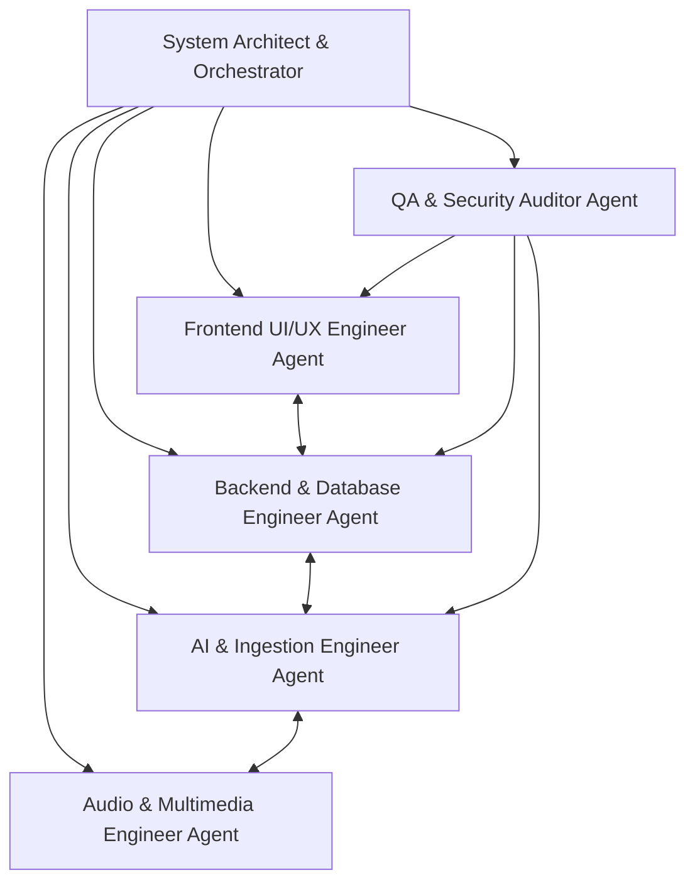

# TechSift AI — Agent Architecture & Engineering Roles

This document defines the specialized agent personas and engineering boundaries used during the development, testing, and lifecycle of **TechSift AI**.

---

## 1. Multi-Agent Development System

---

## 2. Specialized Roles & Responsibilities

### 2.1 System Architect & Orchestrator
* **Mission**: High-level system design, cross-domain coordination, dependency management, and phase gating.
* **Responsibilities**:
  * Enforces the zero-cost architecture rule across all technical choices.
  * Ensures compliance with layered architectural boundaries.
  * Manages phase transitions (Phase 0 $\to$ Phase 1 $\to$ Phase 2).
* **Guiding Principle**: Never allow infrastructure bloat or paid service creep.

### 2.2 Backend & Database Engineer Agent
* **Mission**: High-performance, asynchronous REST API and local SQLite data tier.
* **Responsibilities**:
  * Develops FastAPI routers, dependency injection, and Pydantic schemas.
  * Implements SQLAlchemy 2.0 async models and migrations.
  * Manages local file storage transactions and cleanups.
  * Implements token-bucket rate limiting to protect free-tier AI quotas.
* **Stack**: Python 3.12, FastAPI, SQLAlchemy, aiosqlite, Pydantic v2.

### 2.3 AI & Ingestion Engineer Agent
* **Mission**: PDF document parsing, semantic text chunking, prompt engineering, and LLM integration.
* **Responsibilities**:
  * Develops robust PDF text extraction with error tolerance using `pypdf`.
  * Implements sliding-window overlapping chunking algorithms.
  * Designs structured prompts for document summarization, glossary term extraction, and Q&A.
  * Integrates the official `google-genai` SDK using verified free-tier models (`gemini-2.5-flash`).
  * Enforces abstract `AIProvider` interface to decouple vendor logic.

### 2.4 Audio & Multimedia Engineer Agent
* **Mission**: Speech synthesis and audio narration delivery.
* **Responsibilities**:
  * Manages audio generation pipelines with zero external billing.
  * Implements fallback-first audio strategy: local offline synthesis (`pyttsx3`, OS native) and client-side Web Speech API.
  * Ensures generated audio files are formatted, tagged, and streamed cleanly via FastAPI streaming responses.

### 2.5 Frontend UI/UX Engineer Agent
* **Mission**: Clean, responsive, developer-centric technical document learning dashboard.
* **Responsibilities**:
  * Develops modular React 19 + TypeScript components with Vite.
  * Builds drag-and-drop PDF upload zone with progress indicators.
  * Implements interactive document viewer with synchronized summary cards, glossary drawer, and audio playback controls.
  * Integrates Tailwind CSS for modern, dark-mode-first aesthetic.

### 2.6 QA & Security Auditor Agent
* **Mission**: Code quality, test coverage, zero-cost auditing, and secret leakage prevention.
* **Responsibilities**:
  * Maintains pytest suite for backend and Vitest/build tests for frontend.
  * Verifies that no API keys or secrets are ever exposed in code or commits.
  * Audits dependencies to ensure no unverified paid packages are introduced.
  * Asserts HTTP contract stability between backend and frontend.

---

## 3. Communication & Operating Protocols

1. **Gatekeeping**: No agent may proceed to subsequent development phases without passing all automated assertions in the current phase.
2. **Deterministic Fallbacks**: Every external network call (AI, audio) must have a graceful degradation path or offline alternative.
3. **Traceability**: All architectural deviations must be logged in project documentation.
