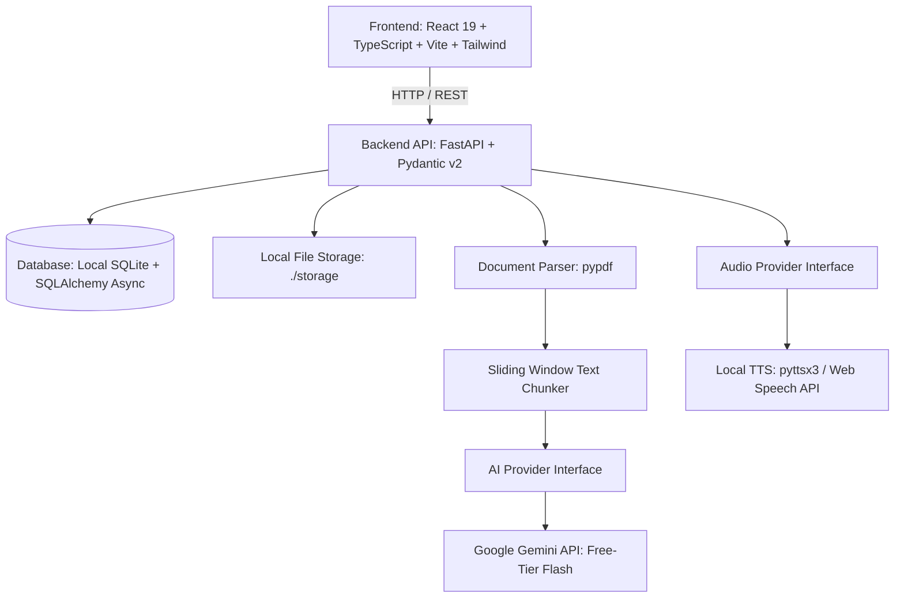
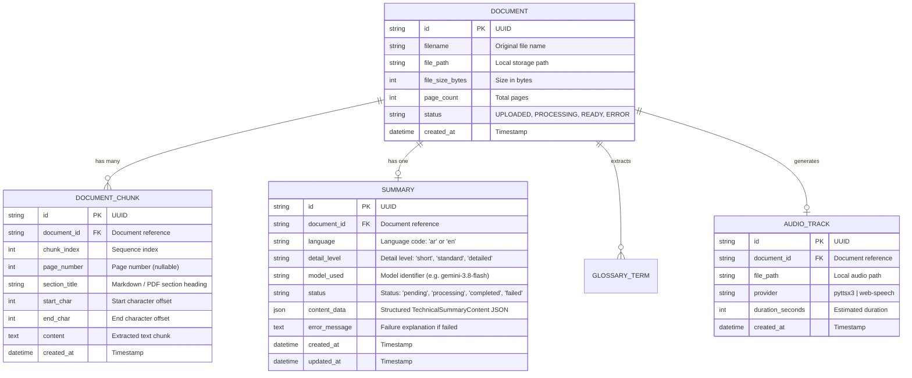

# TechSift AI — Project Specification

## 1. Project Overview & Objectives

**TechSift AI** is a professional, production-style AI-powered technical document analysis and learning platform. It allows software engineers, students, and technical researchers to upload technical papers, architecture specs, and documentation PDFs, automatically extracting key concepts, generating structured summaries, building glossaries, and providing audio narrations—all with **zero operational cost**.

This repository is designed as a portfolio-grade project for Python Backend and AI Engineering roles, demonstrating:
* Clean, modular architecture following Domain-Driven and Layered Design patterns.
* Strict adherence to zero-cost, local-first engineering principles.
* Production-grade error handling, logging, and validation.
* Robust automated testing (unit, integration, and contract tests).
* Modern React + TypeScript user experience.

---

## 2. Core Architecture & Tech Stack

### Backend Stack
* **Language & Runtime**: Python 3.12+ (isolated virtual environment)
* **Web Framework**: FastAPI (asynchronous ASGI)
* **Validation & Settings**: Pydantic v2 & Pydantic-Settings
* **Database & ORM**: SQLite + SQLAlchemy 2.0 (async via `aiosqlite`)
* **Document Ingestion**: `pypdf` (open-source, memory-efficient PDF parser)
* **Audio Synthesis**: Modular provider pattern supporting `pyttsx3`, OS native synthesis, and browser Web Speech API.
* **Testing**: Pytest, Pytest-Asyncio, HTTPX

### Frontend Stack
* **Framework**: React 19 + TypeScript
* **Build Tool**: Vite 8
* **Styling**: Tailwind CSS
* **Icons & UI Elements**: Lucide React / Tailwind UI components
* **HTTP Client**: Native Fetch API / Axios with typed contracts

---

## 3. Data Model & Database Schema (SQLite)

---

## 4. API Endpoints Specification

### 4.1 System & Health
* `GET /health`  
  Returns server health status, application name, version, and runtime environment.
* `GET /api/v1/health`  
  Structured health check endpoint returning API status, version, and environment.

### 4.2 Document Management
* `POST /api/v1/documents`  
  Accepts a `multipart/form-data` file (`.pdf`, `.txt`, `.md`). Validates size (max 15MB) during streaming, verifies magic bytes, saves locally in `storage/documents/`, extracts text, and detects scanned PDFs.
* `GET /api/v1/documents`  
  Lists all analyzed documents with pagination (`page`, `page_size`, `status`).
* `GET /api/v1/documents/{id}`  
  Retrieves document metadata and full extracted text.
* `DELETE /api/v1/documents/{id}`  
  Deletes document records and cascades to chunks, summaries, and cleans up local storage.

### 4.3 Bilingual AI Summarization & Intelligence
* `POST /api/v1/documents/{id}/summaries`  
  Initiates bilingual (Modern Standard Arabic `ar` or English `en`) technical summarization at configurable detail levels (`short`, `standard`, `detailed`). Supports asynchronous background processing (`wait=false`) or synchronous wait (`wait=true`). Checks SQLite cache first—returns identical completed summaries with zero API calls.
* `GET /api/v1/documents/{id}/summaries`  
  Retrieves all summaries generated for a document.
* `GET /api/v1/summaries/{id}`  
  Retrieves a specific summary by UUID with full structured `TechnicalSummaryContent` JSON, citations, and metadata.

### 4.4 Bilingual Audio & Podcast Studio
* `POST /api/v1/documents/{id}/audio`  
  Generates bilingual technical audio in either **Narration** mode (single-speaker summary) or **Podcast** mode (dual-speaker educational dialogue between Host and Co-host with 450ms conversational pauses). Supports `wait=true` synchronous wait or background async execution with SQLite job tracking. Checks SHA-256 fingerprint cache first for zero-cost immediate returns.
* `GET /api/v1/documents/{id}/audio`  
  Lists all audio tracks generated for a document.
* `GET /api/v1/audio/{id}`  
  Retrieves metadata, status, voice config, and script content for a specific audio track.
* `GET /api/v1/audio/{id}/stream`  
  Streams the generated MP3 file with full RFC 7233 HTTP 206 Partial Content byte-range support for browser seeking and scrubbing.
* `GET /api/v1/audio/{id}/download`  
  Downloads the audio track as an MP3 attachment with sanitized Content-Disposition headers.
* `GET /api/v1/audio/voices`  
  Returns catalog of verified zero-cost neural voices for Arabic and English.

---

## 5. Security & Zero-Cost Governance

1. **Zero External Billing**:
   * No paid cloud services (no AWS, GCP billing, Azure, Redis Cloud, or managed Postgres).
   * All persistence runs locally via SQLite.
2. **API Key Isolation**:
   * Keys are loaded exclusively via environment variables (`.env`).
   * Keys are never exposed in logs, responses, or client bundles.
3. **Local File Sandboxing**:
   * Uploaded files are assigned random UUIDs to prevent directory traversal attacks.
   * File uploads are restricted to `.pdf` with content inspection.
4. **Rate Limit Defenses**:
   * Free-tier Gemini usage is throttled locally to remain under the 15 RPM / 1500 RPD quotas.
