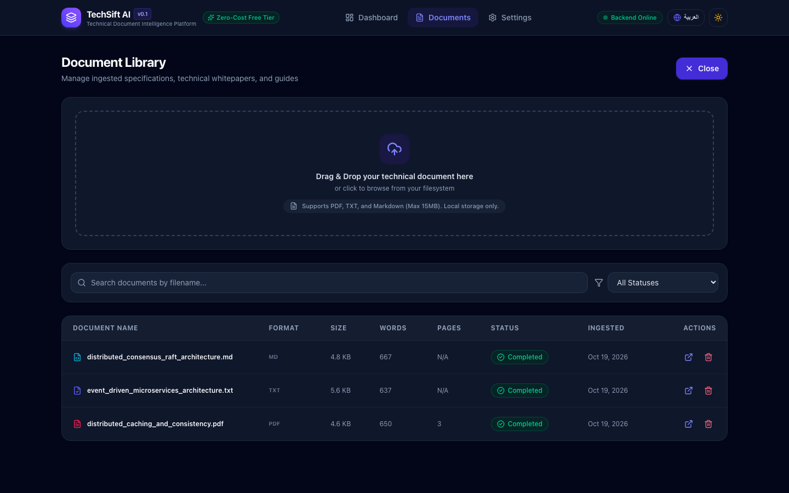
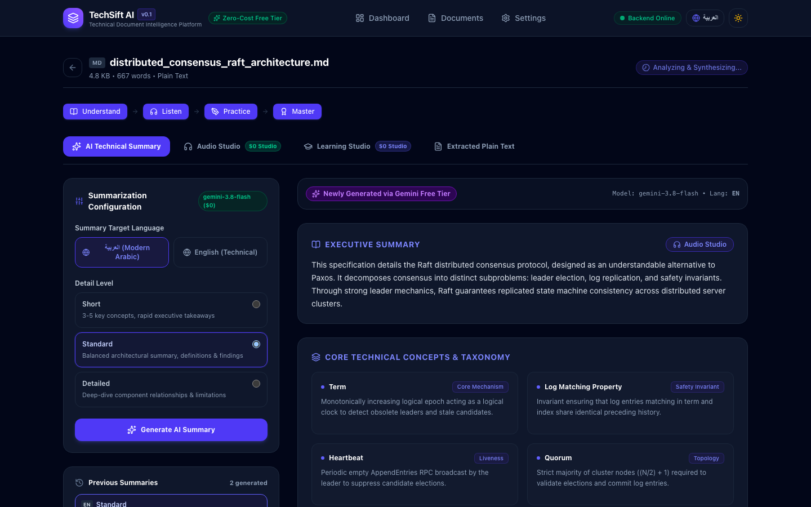
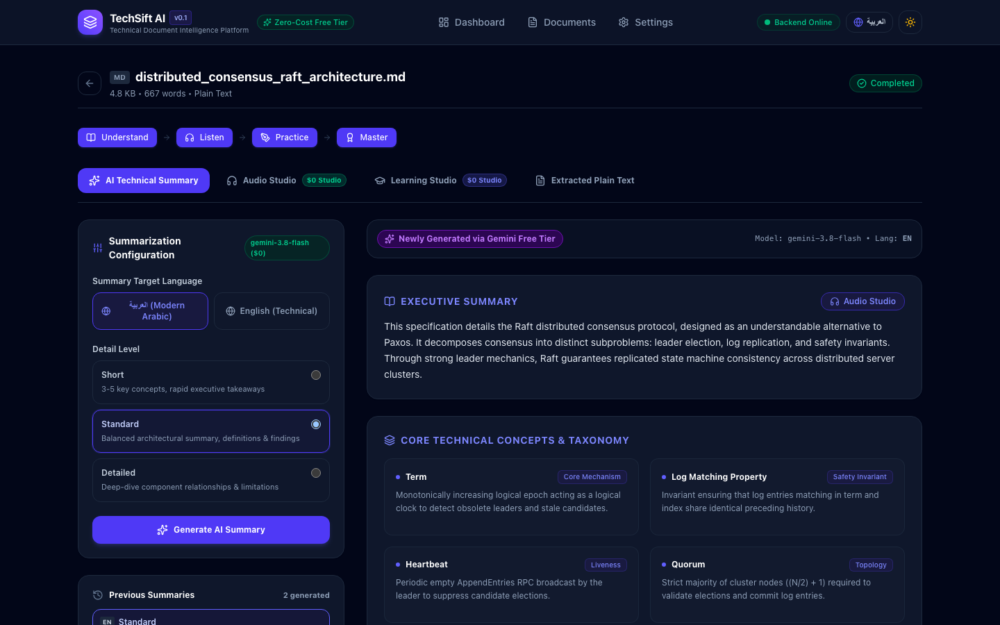
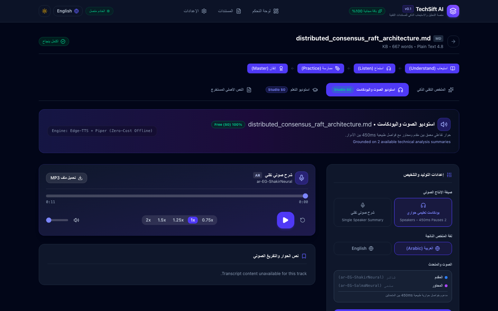
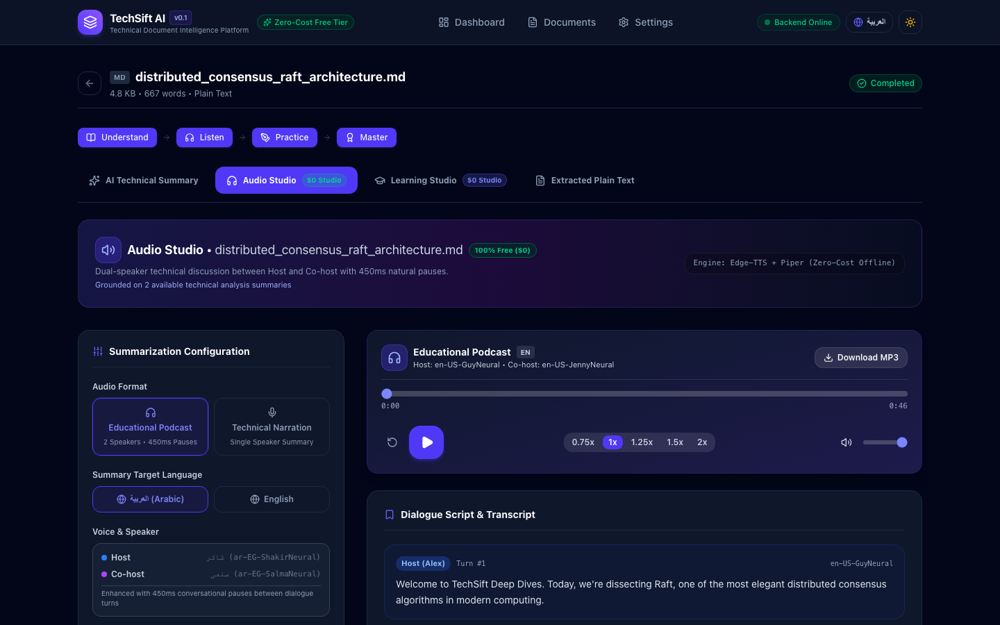
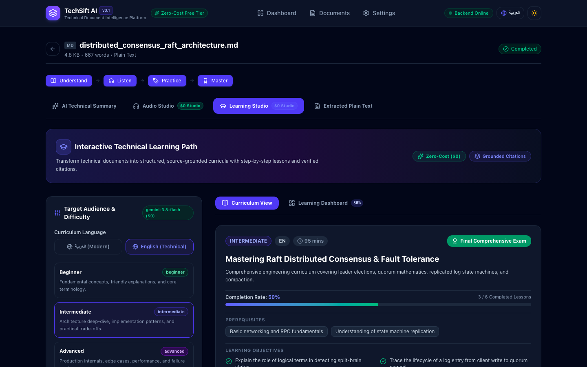
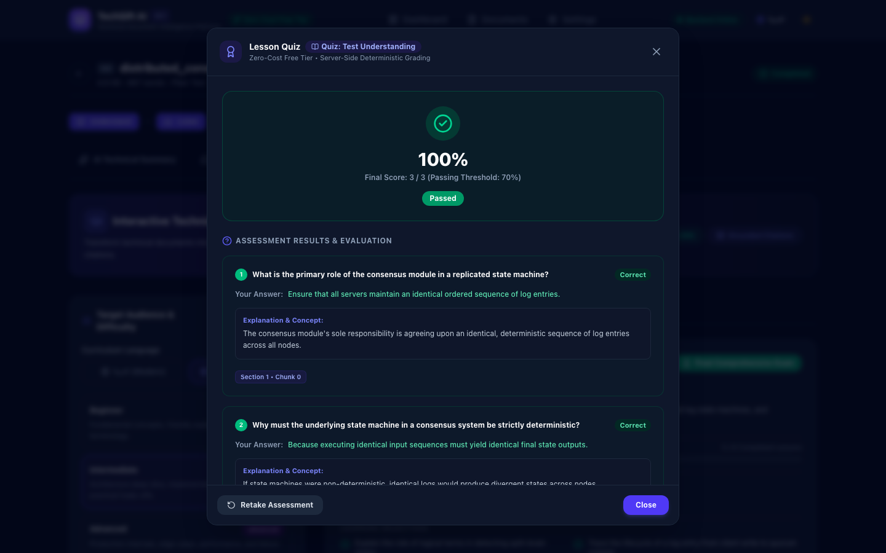
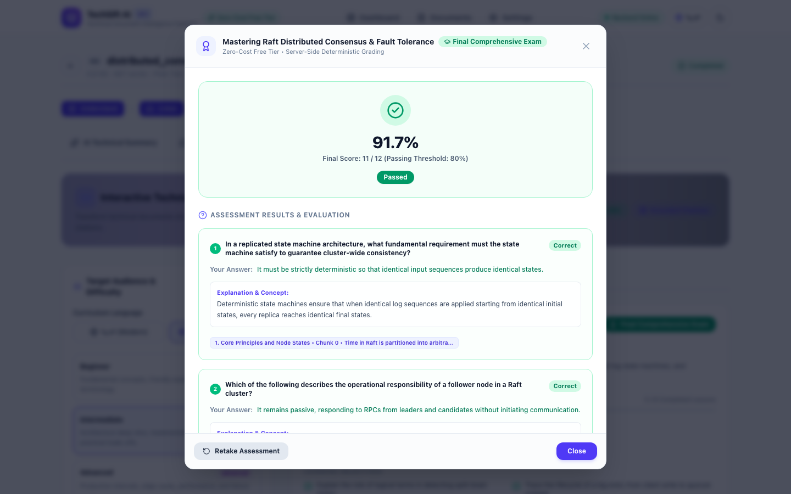
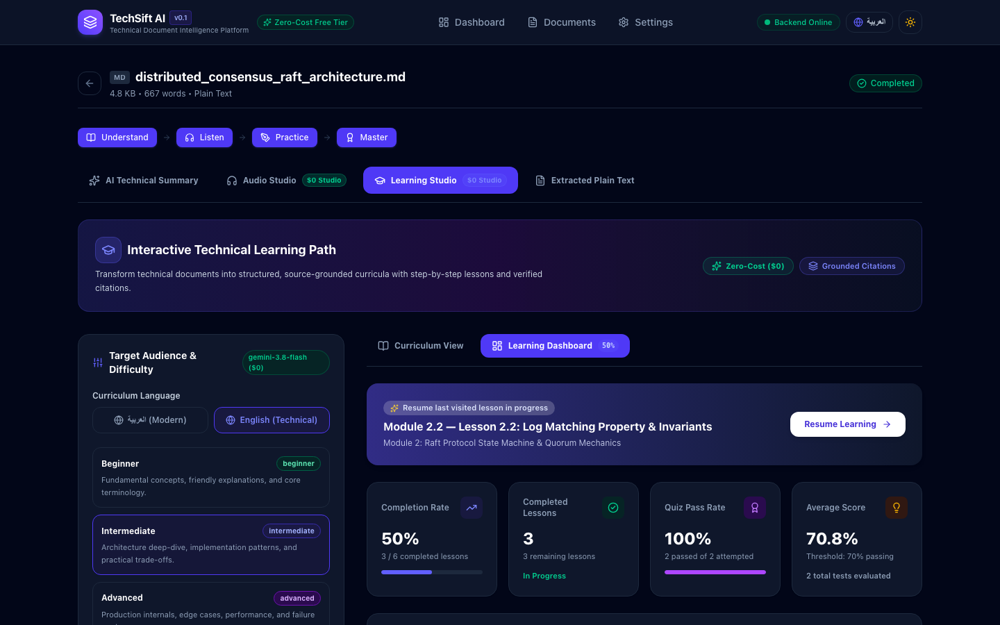
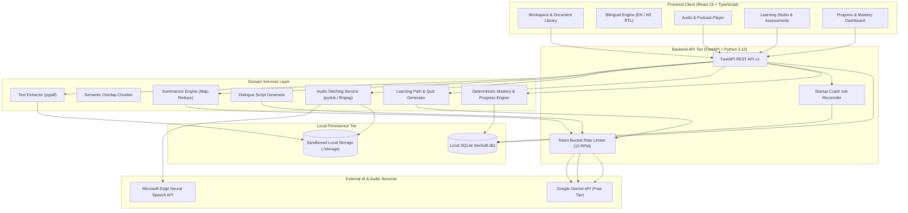

# TechSift AI

> **Local-First AI Technical Document Intelligence & Interactive Learning Platform**

TechSift AI transforms complex technical documentation—architectural whitepapers, engineering specifications, and RFCs in PDF, Markdown, and Plain Text—into structured bilingual summaries, dual-speaker educational podcasts, source-grounded learning paths, and interactive self-assessments. 

Built with a local-first architecture, TechSift AI combines an asynchronous Python backend and a React dashboard with intelligent rate limiting, local SQLite storage, and free-tier AI integration.

---

## 📸 Visual Showcase & Screenshots

All screenshots below represent the authentic, running application UI captured at desktop standard `1440 × 900` using synthetic technical whitepapers from [`samples/`](samples/).

### 1. Document Library & Ingestion Pipeline
| Multi-Format Document Library | Asynchronous Ingestion & Processing Pipeline |
| :---: | :---: |
|  |  |
| *Universal dropzone supporting PDF, Markdown, and TXT with format badges and storage metrics.* | *Live status indicators, stage feedback, and Knowledge Journey stepper.* |

### 2. Deep Architectural Summaries & Bilingual Audio Studio
| Bilingual Technical Summaries | Arabic RTL Speech Studio |
| :---: | :---: |
|  |  |
| *Executive summary, architectural takeaways, concepts taxonomy, and verifiable citations.* | *Native Arabic typography (IBM Plex Sans Arabic), right-to-left layout, and custom waveform player.* |

### 3. Educational Podcasts & Interactive Curricula
| Dual-Speaker Educational Podcast | Structured 3-Tier Learning Path |
| :---: | :---: |
|  |  |
| *Multi-voice dialogue between Host and Co-host with 450ms natural pauses and transcript.* | *Sequential modules and step-by-step lessons with time estimates and source grounding.* |

### 4. Interactive Assessments & Knowledge Mastery
| Check-for-Understanding Quiz Modal | Capstone Certification Exam (Light Mode) |
| :---: | :---: |
|  |  |
| *Instant rationale feedback, correct answer verification, and source chunk citations.* | *12-question final examination in light mode with score gauge and review breakdown.* |

### 5. Learning Progress & Knowledge Mastery Dashboard

*Real-time curriculum progress, average score gauges, module mastery breakdown, and session continuity.*

---

## 🌟 Implemented Features

### 1. Multi-Format Ingestion & Robust Text Extraction
* **Universal Document Ingestion**: Ingests technical documentation in `.pdf`, `.txt`, and `.md` formats up to 15 MB.
* **Deep PDF Extraction**: Page-by-page extraction using `pypdf` with automated scanned/image-only PDF detection and word count analysis.
* **UUID Content Addressing**: Files are stored under unique UUIDs to prevent directory traversal (`../`) attacks, with atomic cleanup on deletion.

### 2. Bilingual AI Summaries & Concepts Taxonomy
* **Official Google GenAI SDK**: Integrates `gemini-3.8-flash` via the official `google-genai` SDK with automated runtime fallback (`gemini-3.5-flash`, `gemini-flash-latest`).
* **Semantic Text Chunking**: Sliding-window overlapping text chunker with heading preservation for documents of arbitrary length.
* **Map-Reduce Pipeline**: Two-stage summarization architecture handling long documents exceeding single-call token windows.
* **Deterministic Caching**: Identical summary parameters return immediately from local SQLite (`is_cached: true`) without external API consumption.
* **Bilingual Taxonomy**: Pydantic-validated output containing Executive Overview, Core Concepts Taxonomy, Key Takeaways, and Page/Chunk Citations in English and Modern Standard Arabic.

### 3. Audio Studio & Dual-Speaker Educational Podcasts
* **Technical Narration**: Single-speaker audio narration using Microsoft neural voices in Arabic (`ar-EG-ShakirNeural`, `ar-EG-SalmaNeural`) and English (`en-US-GuyNeural`, `en-US-JennyNeural`) via Edge-TTS.
* **Conversational Podcasts**: Structured dialogue scripts between technical hosts with 450ms natural conversational pauses.
* **Audio Stitching & Processing**: MP3 generation and concatenation via `pydub` and `ffmpeg`, with sentence splitting under 700 characters to prevent connection timeouts.
* **RFC 7233 Byte-Range Streaming**: HTTP 206 Partial Content streaming for instant browser seeking and audio scrubbing.

### 4. Interactive Learning Studio & Tiered Curricula
* **Multi-Tier Curricula**: Generates structured, source-grounded learning paths customized for Beginner, Intermediate, and Advanced skill levels.
* **Modular Hierarchy**: Organizes learning paths into sequential Modules and step-by-step Lessons.
* **Source-Grounded Lessons**: Lessons contain explanations, code examples, key terms, and citations linking back to original document sections.

### 5. Interactive Quizzes & Deterministic Local Grading
* **Tiered Evaluations**: Lesson-level check-for-understanding quizzes, module milestone assessments, and capstone final exams.
* **100% Local Deterministic Grading**: Real-time scoring, percentage calculation, and pass/fail evaluation executed entirely in SQLite without external LLM calls during examination.
* **Pedagogical Explanations**: Instant feedback for every question, displaying correct answers, pedagogical rationale, and source citation references.

### 6. Learning Progress & Knowledge Mastery Dashboard
* **State Machine Tracking**: Progress states (`not_started`, `in_progress`, `completed`) with regression protection (revisiting completed lessons never resets progress).
* **Session Continuity**: Dedicated pointer tracking (`last_visited_lesson_id`) enabling one-click "Resume Learning".
* **Dynamic Metric Aggregation**: Path and module completion percentages computed dynamically at query time from database records.
* **Deterministic Knowledge Mastery**: Evaluates concept mastery from quiz attempts:
  * **Strong Concepts** ($\ge 80\%$ accuracy).
  * **Concepts Needing Review** ($< 70\%$ accuracy).
  * **Frequently Missed Questions** ($\ge 50\%$ failure rate).

---

## 🛠️ Technology Stack

| Layer | Technologies |
| :--- | :--- |
| **Frontend Framework** | React 19, TypeScript, Vite 8 |
| **Styling & Design System** | Tailwind CSS v4, Lucide React icons, Custom CSS scrollbars |
| **State & Navigation** | React Router v7, TanStack Query v5 |
| **Internationalization** | Bilingual (English LTR & Modern Standard Arabic RTL), 360+ static translation keys |
| **Backend Framework** | Python 3.12, FastAPI, Uvicorn (ASGI) |
| **Data Validation** | Pydantic v2, Pydantic-Settings |
| **Database & ORM** | SQLite, SQLAlchemy 2.0 (Async), `aiosqlite`, Alembic |
| **Document Processing** | `pypdf`, `reportlab` |
| **AI / LLM Integration** | Google Gemini API (`gemini-3.8-flash` with fallbacks), `google-genai` SDK |
| **Speech & Audio Engine**| `edge-tts`, `pydub`, `ffmpeg` / `ffprobe`, RFC 7233 Streaming |
| **Testing & Quality** | Pytest (111 tests), Pytest-Asyncio, HTTPX, Oxlint |

---

## 🏗️ System Architecture



---

## 🚀 Installation & Local Setup

### 1. Prerequisites
* **Python 3.12+**
* **Node.js v20.19+ / v22+ and npm v10+** (verified on Node.js v22.17.0)
* **FFmpeg & FFprobe** (required for MP3 generation and audio streaming):
  * **macOS** (Homebrew): `brew install ffmpeg`
  * **Ubuntu / Debian**: `sudo apt update && sudo apt install -y ffmpeg`
  * **Windows** (winget): `winget install Gyan.FFmpeg`

### 2. Clone Repository & Setup Virtual Environment
```bash
git clone https://github.com/your-username/techsift-ai.git
cd techsift-ai

python3 -m venv .venv
source .venv/bin/activate
pip install -r requirements.txt
```

### 3. Configure Environment Variables
Copy the configuration template:
```bash
cp .env.example .env
```
Edit `.env` to supply your Google Gemini API key:
```ini
GEMINI_API_KEY=your_gemini_api_key_here
GEMINI_MODEL=gemini-3.8-flash
APP_ENV=development
DEBUG=True
DATABASE_URL=sqlite+aiosqlite:///./techsift.db
STORAGE_DIR=./storage
AUDIO_PROVIDER=edge-tts
```
> *(A free Gemini API key can be obtained in seconds at [Google AI Studio](https://aistudio.google.com/app/apikey) without entering credit card or billing details).*

### 4. Initialize Database Schema
Run Alembic migrations to create the local SQLite schema:
```bash
alembic upgrade head
```

### 5. Start Backend API Server
```bash
uvicorn src.api.main:app --host 127.0.0.1 --port 8000 --reload
```
* **API Root**: `http://127.0.0.1:8000`
* **Interactive Swagger Docs**: `http://127.0.0.1:8000/docs`
* **ReDoc Specification**: `http://127.0.0.1:8000/redoc`

### 6. Start Frontend Dashboard
In a separate terminal:
```bash
cd frontend
npm install
npm run dev
```
* **Web Application**: `http://localhost:5173`

### 7. Try with Synthetic Samples
Ingest any of the sample files in [`samples/`](samples/) (`.pdf`, `.txt`, `.md`) to test text extraction, AI summarization, audio generation, and interactive quizzes immediately.

---

## 🧪 Testing & Code Quality

### Backend Pytest Suite
Run the full automated test suite (111 tests covering models, services, rate limiters, audio stitching, and API endpoints):
```bash
pytest -v
```
Expected output:
```text
======================= 111 passed, 2 warnings in ~11s =======================
```

### Frontend Build & Lint
Verify TypeScript types and code quality:
```bash
cd frontend
npm run build   # TypeScript compilation & Vite bundle check
npm run lint    # Oxlint static analysis
```

### Schema Drift Verification
Assert zero migration drift between SQLAlchemy models and Alembic migrations:
```bash
alembic check
```

---

## 🔒 Security & Privacy Considerations

* **Local-First Data Storage**: Uploaded documents, database records, and generated audio files are stored strictly on the local machine (`./storage/`, `./techsift.db`). They are never uploaded to any remote server or shared storage.
* **API Secret Protection**: API keys are read strictly from `.env` or system environment variables. Log traces automatically sanitize keys using `mask_secret()`.
* **Path Traversal Protection**: File operations use generated UUIDs for disk persistence rather than user-provided filenames, preventing path traversal (`../`) attacks.
* **Confidential Assessments**: Exam answer keys and explanations are held server-side and never sent to the client during active test-taking. They are only revealed upon grading submission.

---

## ⚠️ Prototype Scope & Limitations

* **External API Availability**: Google Gemini free-tier quotas (15 RPM / 1M TPM) and Microsoft Edge-TTS endpoints are third-party services subject to external rate limits, availability, and policy changes.
* **Token-Bucket Rate Limiter**: The application implements an internal rate limiter targeting 10 RPM to prevent quota exhaustion on Gemini's free tier. Burst requests may queue or return HTTP 429 if the quota is exceeded.
* **Single-Node Architecture**: Designed for local development and single-user technical exploration. It uses SQLite and in-memory background tasks. Scaling to multi-tenant production would require PostgreSQL, Redis/Celery task queues, and S3-compatible object storage.

---

## 📄 License

This project is open-source and available under the [MIT License](LICENSE).
